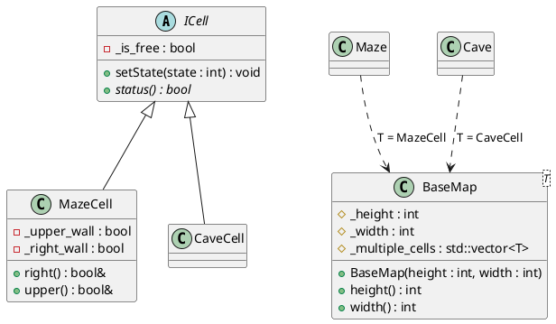

## Необходимые классы
- MazeCell: ячейка в лабиринте, у которой есть границы
- Maze: лабиринт, состоящий из MazeCell ячеек
- MainWindow: главный класс, управляющий всеми компонентами программы
- UIWindow: отрисовка интерфейса

Дополнительно:
- CaveCell: ячейка в пещере, которая хранит только внутренее состояние
- Cave: пещера, состоящая из CaveCell ячеек

